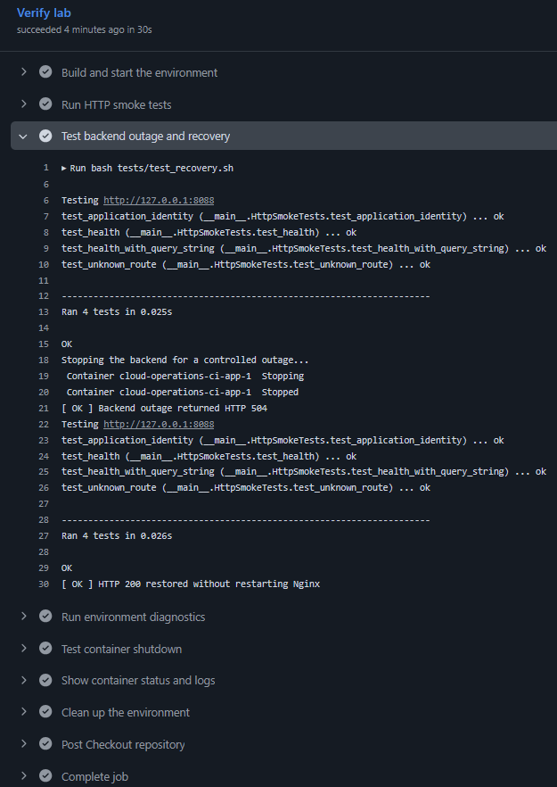

# Cloud Operations Lab

A local lab for investigating HTTP availability issues, documenting incident
recovery and testing operational improvements with Python, Nginx and Docker Compose.

## Environment

- Python HTTP application with `/` and `/health` endpoints.
- Nginx reverse proxy accessible at `127.0.0.1:8088`.
- Application and proxy healthchecks with startup dependencies.
- Non-root application container with SIGTERM and SIGINT handling.
- Read-only application filesystem, dropped capabilities and no-new-privileges.
- Container log rotation.
- JSON request logs correlated across Nginx and the application using request IDs.
- Automated outage, recovery and diagnostic failure checks.

The Python application listens on port 8000 inside the Compose network.

## Run locally

Requirements: Git, Docker Engine, Docker Compose, Bash and curl.
Python 3 is also required for Python tests and health snapshots.

```bash
git clone https://github.com/Gabrieldelacerda/cloud-operations-lab.git
cd cloud-operations-lab
docker compose up -d --build --wait --wait-timeout 60
docker compose ps
curl -i --max-time 5 http://127.0.0.1:8088/health
```

Expected health response: HTTP 200 with `{"status": "ok"}`.
When using a VM, execute these commands inside that VM.

## Troubleshooting

Check service state, health, recent logs and the HTTP health response:

```bash
bash scripts/diagnose.sh
```

Diagnostics return a nonzero exit code for missing, stopped or unhealthy
services, failed commands or an unsuccessful HTTP health request.
The script collects evidence without modifying the environment.

Inspect recent Docker healthcheck results:

```bash
python3 scripts/health_snapshot.py
```

The snapshot includes probe history, process status, exit codes and the
OOM indicator. Successful collection does not imply healthy services.

For individual checks:

```bash
docker compose ps -a
docker compose logs --tail=100
curl -i --max-time 5 http://127.0.0.1:8088/health
```

See the [operations guide](docs/operations.md) for healthchecks, container
restrictions, log rotation, recovery and diagnostic exit behavior.

## Request correlation

Nginx returns an `X-Request-ID` response header and forwards the generated
ID to the application. Both services record it in their JSON request logs.

```bash
curl --silent --show-error --include --write-out '\n' \
  'http://127.0.0.1:8088/health?source=correlation'
docker compose logs --no-color --no-log-prefix --tail 100 nginx
docker compose logs --no-color --no-log-prefix --tail 100 app
```

Match the response header to the `request_id` in both logs.
Direct application healthchecks bypass Nginx and have a null request ID.
A proxy failure before reaching the application may have no application entry.

See the [logging guide](docs/logging.md) for field definitions,
HTTP failure investigation and observed log-retrieval limitations.

## Automated tests

With the environment running:

```bash
python3 tests/http_smoke.py
python3 tests/test_access_logs.py
bash tests/test_shutdown.sh
bash tests/test_recovery.sh
bash tests/test_diagnostics.sh
```

| Suite | Verifies |
| --- | --- |
| HTTP smoke | Application identity, health, query strings and unknown routes |
| Access logs | Correlated IDs, JSON escaping, statuses, timestamps and upstream timings |
| Shutdown | SIGTERM/SIGINT handling, exit code 0, OOM indicator and shutdown logs |
| Recovery | HTTP failure and recovery, healthy containers and no Nginx restart |
| Diagnostics | Success when healthy, failure with a stopped backend and success after restoration |

Shutdown tests use isolated temporary containers that are removed afterward.

Recovery and diagnostic tests temporarily interrupt the current lab
application. Their exit handlers attempt restoration after failures or
interruptions. They cannot recover from every failure condition.

See the [operations guide](docs/operations.md) for cleanup limitations
and manual recovery.

## Continuous integration

[Lab Checks](https://github.com/Gabrieldelacerda/cloud-operations-lab/actions/workflows/lab-checks.yml)
runs on pushes, pull requests and manual execution.

The workflow validates shell syntax and Compose configuration, builds the
environment, runs all five test suites and executes environment diagnostics.

Before cleanup, it attempts to upload a
`lab-diagnostics-<run-id>-<attempt>` artifact with seven-day retention:

- `container-status.txt`: container states.
- `compose.log`: latest 100 log lines per service.
- `health-status.json`: service state and recent healthcheck history.

Download the artifact from the workflow run's Summary page to investigate
the environment after its containers are removed.

Collection, upload and cleanup are attempted even after test failures.
Runner loss or collection errors can prevent complete evidence from being saved.



## Incident investigation

[Incident 001: Backend unavailable](docs/incidents/001-backend-unavailable.md)

The original controlled outage produced HTTP 504 while Nginx remained running.
Logs identified a connection timeout to the stopped backend. Starting the
application restored HTTP 200 without restarting Nginx.

The investigation also exposed slow shutdown, which led to explicit signal
handling and automated shutdown tests. Backend outage, recovery and diagnostic
failure detection are now tested locally and in CI.

## Reproduce a slow-backend timeout

In [Incident 001](docs/incidents/001-backend-unavailable.md), Nginx timed out
while connecting to the stopped backend. In
[Incident 002](docs/incidents/002-slow-backend.md), Nginx connected but timed
out waiting for response headers. Both incidents produced HTTP 504. The
Nginx error log identifies which phase timed out.

Run the slow-backend scenario in the local lab:

```bash
bash tests/test_slow_backend.sh
```

The test enables the slow route, matches the 504 response to the Nginx logs
and restores the default Compose configuration. In GitHub Actions, the
diagnostics artifact includes the test output in `slow-backend.log`.

## Inspect proxy diagnostics

Open the GitHub Actions run summary for Nginx response counts and request
timing. The diagnostics artifact includes `proxy-summary.json`, which also
groups HTTP 5xx responses by route.

The latency figures use Nginx's total request time and cover only the
collected log window. Health checks and deliberate failures can appear in
that sample. See the [logging guide](docs/logging.md#summarize-proxy-responses)
to recreate the report locally or trace a single request by ID.

## Evidence

- [Structured Nginx access logs](screenshots/NginxAccessLogs.png)
- [Application 404 log](screenshots/404log.png)
- [Backend outage log](screenshots/BEOutage.png)
- [Backend outage and recovery](screenshots/testrecovery.png)
- [Environment diagnostics in CI](screenshots/Environment_Diagnostics_CI.png)
- [Application restrictions](screenshots/AppRestrictions.png)
- [Healthchecks and log rotation](screenshots/HealthChecks_LogRotation.png)
- [Running services and HTTP 200](screenshots/composeps.png)
- [Clean application shutdown](screenshots/CleanShutdown.png)
- [HTTP and shutdown test results](screenshots/citestresults.png)
- [Docker image build](screenshots/DockerBuild.png)
- [Environment startup](screenshots/DockerCompose.png)

## Stop the environment

```bash
docker compose down
```

## Scope

This is a local learning environment using Python's standard-library HTTP
server. Recovery is explicitly performed by the test scripts; the lab does
not implement automatic failover. Cloud infrastructure and additional
incident scenarios are planned extensions.
