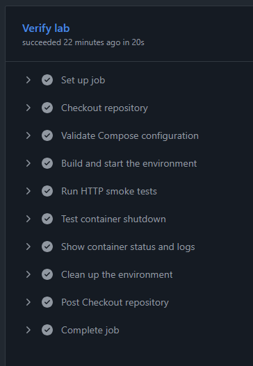

# Cloud Operations Lab

A local lab for investigating HTTP availability issues, documenting incident
recovery and testing operational improvements with Python, Nginx and Docker Compose.

## Environment

- Python HTTP application with `/` and `/health` endpoints.
- Nginx reverse proxy accessible at `127.0.0.1:8088`.
- Application healthcheck and startup dependencies configured in Compose.
- Non-root application container with SIGTERM and SIGINT handling.

The Python application listens on port 8000 inside the Compose network.

## Run locally

Requirements: Git, Docker Engine, Docker Compose, Bash and curl.
Python 3 is also required to run the HTTP tests.

```bash
git clone https://github.com/Gabrieldelacerda/cloud-operations-lab.git
cd cloud-operations-lab
docker compose up -d --build --wait
docker compose ps
curl -i --max-time 5 http://127.0.0.1:8088/health
```

Expected health response: HTTP 200 with `{"status": "ok"}`.
When using a VM, execute these commands inside that VM.

## Automated tests

With the environment running:

```bash
python3 tests/http_smoke.py
bash tests/test_shutdown.sh
```

The HTTP suite checks application identity, health responses, query strings
and unknown routes through Nginx.

The shutdown suite creates isolated temporary containers and verifies
SIGTERM and SIGINT handling, exit code 0, the OOM indicator and shutdown logs.
Temporary containers are removed after testing.

## Continuous integration

[Lab Checks](https://github.com/Gabrieldelacerda/cloud-operations-lab/actions/workflows/lab-checks.yml)
runs on pushes, pull requests and manual execution.

The workflow validates Compose, builds the environment, runs both test suites
and collects logs before cleanup.



## Incident investigation

[Incident 001: Backend unavailable](docs/incidents/001-backend-unavailable.md)

The original controlled outage produced HTTP 504 while Nginx remained running.
Logs identified a connection timeout to the stopped backend. Starting the
application restored HTTP 200 without restarting Nginx.

The investigation also exposed slow shutdown, which led to explicit signal
handling and automated shutdown tests.

## Evidence

- [Running services and HTTP 200](screenshots/composeps.png)
- [Clean application shutdown](screenshots/CleanShutdown.png)
- [CI test results](screenshots/citestresults.png)
- [Docker image build](screenshots/DockerBuild.png)
- [Environment startup](screenshots/DockerCompose.png)

## Stop the environment

```bash
docker compose down
```

## Scope

This is a local learning environment using Python's standard-library HTTP
server. Cloud infrastructure and additional incident scenarios are planned
extensions.