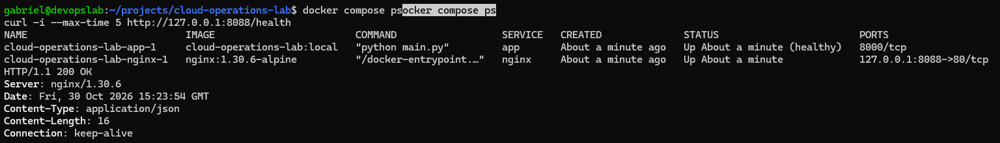

# Cloud Operations Lab

A hands-on lab for Linux troubleshooting, incident recovery and operational
improvements using Python, Nginx and Docker Compose.

The focus is on reproducing failures, investigating evidence, restoring
service and improving application behavior.

## Current environment

- Python HTTP application with `/` and `/health` endpoints.
- Nginx reverse proxy forwarding requests to the application.
- Docker Compose with an application healthcheck and startup dependencies.
- Application container running as a non-root user.
- Explicit SIGTERM and SIGINT handling for controlled process shutdown.

Nginx is accessible at `127.0.0.1:8088` on the machine running Docker.
The Python application listens on port 8000 inside the Compose network.

## Run the lab

Requirements: Git, Docker Engine and Docker Compose.

```bash
git clone https://github.com/Gabrieldelacerda/cloud-operations-lab.git
cd cloud-operations-lab
docker compose up -d --build --wait
```

Check the services and application:

```bash
docker compose ps
curl -i --max-time 5 http://127.0.0.1:8088/health
```

Expected health response: HTTP 200 with `{"status": "ok"}`.

When running inside a VM, execute these checks inside that VM.

## Incident investigation

[Incident 001: Backend unavailable](docs/incidents/001-backend-unavailable.md)

The first controlled outage produced HTTP 504 while Nginx remained running.
The proxy logs showed a timeout while connecting to the stopped backend.

Starting the application restored HTTP 200 without restarting Nginx.

The investigation also exposed slow application shutdown. Signal handling
was subsequently added to allow the process to exit without forced termination.

## Evidence

Service status and HTTP response:



- [Docker image build](screenshots/DockerBuild.png)
- [Environment startup](screenshots/DockerCompose.png)

## Stop the environment

```bash
docker compose down
```

## Scope

This is a local learning environment using Python's standard-library HTTP
server. Cloud infrastructure and additional incident scenarios are planned
extensions.
