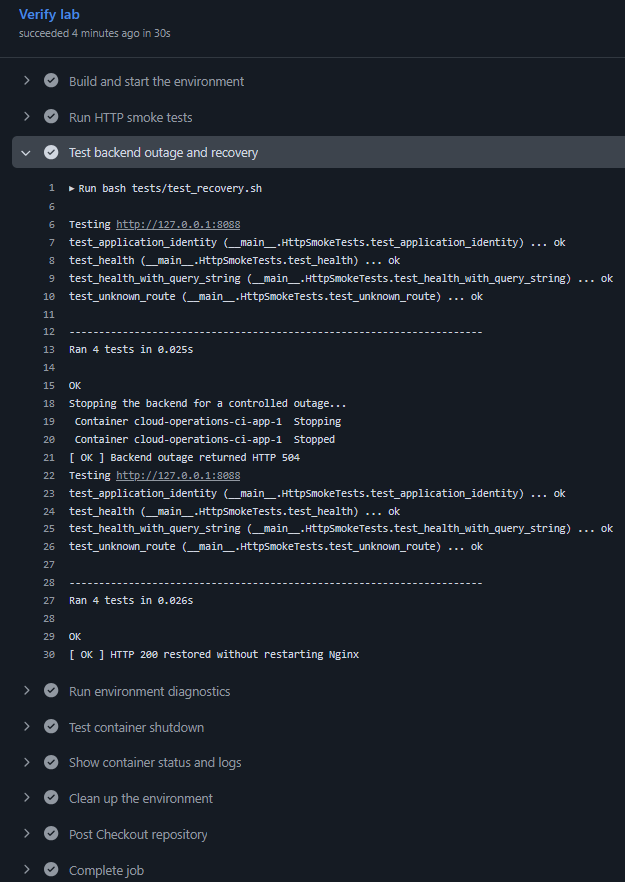

# Cloud Operations Lab

A local lab for investigating HTTP availability issues, documenting incident
recovery and testing operational improvements with Python, Nginx and Docker Compose.

## Environment

- Python HTTP application with `/` and `/health` endpoints.
- Nginx reverse proxy accessible at `127.0.0.1:8088`.
- Application and proxy healthchecks with startup dependencies.
- Non-root application container with SIGTERM and SIGINT handling.
- Read-only application filesystem, dropped capabilities and no-new-privileges.
- Container log rotation.
- JSON request logs correlated across Nginx and the application using request IDs.
- An opt-in slow-backend scenario for investigating proxy read timeouts.

The Python application listens on port 8000 inside the Compose network.

## Run locally

Requirements: Git, Docker Engine, Docker Compose, Bash, curl and Python 3.

```bash
git clone https://github.com/Gabrieldelacerda/cloud-operations-lab.git
cd cloud-operations-lab
docker compose up -d --build --wait --wait-timeout 60
docker compose ps
curl -i --max-time 5 http://127.0.0.1:8088/health
```

Expected health response: HTTP 200 with `{"status": "ok"}`.
When using a VM, execute these commands inside that VM.

## Troubleshooting

Collect container status, recent logs and the HTTP health response:

```bash
bash scripts/diagnose.sh
```

The diagnostic command exits with a nonzero status when required checks fail,
including stopped or unhealthy services.

Capture container state and recent healthcheck results as JSON:

```bash
python3 scripts/health_snapshot.py
```

For individual checks:

```bash
docker compose ps -a
docker compose logs --tail=100
curl -i --max-time 5 http://127.0.0.1:8088/health
```

Use container status, logs and HTTP responses together to investigate a
failure before making changes.

See the [operations guide](docs/operations.md) for healthchecks, container
restrictions, log rotation and recovery procedures.

## Request correlation

Nginx returns an `X-Request-ID` response header and forwards the generated
ID to the application. Both services record it in their JSON request logs.

```bash
curl --silent --show-error --include --write-out '\n' \
  'http://127.0.0.1:8088/health?source=correlation'
docker compose logs --no-color --no-log-prefix --tail 100 nginx
docker compose logs --no-color --no-log-prefix --tail 100 app
```

Match the response header to the `request_id` in both logs.
Direct application healthchecks bypass Nginx and have a null request ID.
A proxy failure before reaching the application may have no application entry.

To search for a specific request, replace the value below with its response ID:

```bash
REQUEST_ID='paste-the-32-character-request-id-here'
python3 scripts/find_request.py "$REQUEST_ID"
```

The lookup also supports saved logs through `--stdin`.

See the [logging guide](docs/logging.md) for field definitions,
HTTP failure investigation and observed log-retrieval limitations.

## Inspect proxy diagnostics

See [how to read the CI summaries](docs/logging.md#read-the-two-summaries-in-github-actions)
to understand the collected log window and the controlled slow-backend probe.

Summarize recent Nginx logs locally:

```bash
(
  set -e
  set -o pipefail
  docker compose logs --no-color --no-log-prefix --tail 100 nginx |
    python3 scripts/summarize_proxy_logs.py > /tmp/lab-proxy-summary.json
  python3 scripts/render_proxy_summary.py /tmp/lab-proxy-summary.json
)
```

The report includes HTTP response counts, p95 and maximum request times,
per-route timing data and routes returning HTTP 5xx.

It also reports requests excluding `/health`, helping separate healthcheck
traffic from other routes.

These figures describe the collected sample. They can include deliberate
test failures and do not represent production availability measurements.

## Automated tests

With the environment running:

```bash
python3 tests/http_smoke.py
python3 tests/test_access_logs.py
python3 tests/test_live_request_lookup.py
bash tests/test_shutdown.sh
bash tests/test_recovery.sh
bash tests/test_diagnostics.sh
```

The HTTP suite checks application identity, health responses, query strings
and unknown routes through Nginx.

The log suite checks correlation between response headers, proxy logs and
application logs, including HTTP 404 responses. It also checks JSON escaping,
distinct request IDs, timestamps and upstream timing fields.

The live lookup test verifies that the request lookup command finds matching
Nginx and application records for a real HTTP request.

The shutdown suite creates isolated temporary containers and verifies
SIGTERM and SIGINT handling, exit code 0, the OOM indicator and shutdown logs.
Temporary containers are removed after testing.

The recovery suite temporarily stops the lab application, expects HTTP
502 or 504, restores the backend and reruns the HTTP checks. It also waits
for both healthchecks and verifies that Nginx was neither restarted nor replaced.

The diagnostic suite checks successful diagnostics, failure detection while
the backend is stopped and successful diagnostics after recovery.

Recovery and diagnostic tests interrupt the current lab. Their cleanup
handlers attempt restoration if a test fails or is interrupted.
See the [operations guide](docs/operations.md) for recovery procedures
and cleanup limitations.

## Continuous integration

[Lab Checks](https://github.com/Gabrieldelacerda/cloud-operations-lab/actions/workflows/lab-checks.yml)
runs on pushes, pull requests and manual execution.

The workflow validates shell syntax and Compose configuration, tests the
diagnostic tools, builds the environment and runs HTTP, log-correlation,
recovery, diagnostic, shutdown and slow-backend checks.

Before cleanup, it collects container status, service logs and healthcheck
history. Diagnostic artifacts use the name
`lab-diagnostics-<run-id>-<attempt>` and have seven-day retention.

Collection, upload and cleanup are attempted even after test failures.
Download the artifact from the workflow run's Summary page to inspect the
saved evidence after the containers are removed.

The Actions job summary displays proxy response counts and timing data.
A separate slow-backend summary preserves evidence from the controlled
timeout before the default environment is restored.



## Incident investigations

### Incident 001: Backend unavailable

[Read the investigation](docs/incidents/001-backend-unavailable.md).

The original controlled outage produced HTTP 504 while Nginx remained running.
Logs identified a connection timeout to the stopped backend. Starting the
application restored HTTP 200 without restarting Nginx.

The investigation also exposed slow shutdown, which led to explicit signal
handling and automated shutdown tests.

### Incident 002: Slow backend

[Read the investigation](docs/incidents/002-slow-backend.md).

Nginx connected to the backend but timed out waiting for response headers.
The error log identified a read timeout, distinguishing it from the
connection timeout in Incident 001.

## Reproduce a slow-backend timeout

Run only against the local lab:

```bash
bash tests/test_slow_backend.sh
```

The test verifies that `/lab/slow` returns HTTP 404 by default, enables the
slow route through `compose.slow.yaml` and checks for HTTP 504.

It correlates the response with Nginx access and error logs, verifies that
`/health` still responds and restores the default configuration.

The cleanup handler attempts restoration after failure or interruption.
If restoration fails, run:

```bash
docker compose up -d --wait --wait-timeout 60
python3 tests/http_smoke.py
```

Both documented incidents produced HTTP 504. The Nginx error log identifies
which phase timed out.

## Evidence

- [Structured Nginx access logs](screenshots/NginxAccessLogs.png)
- [Application 404 log](screenshots/404log.png)
- [Backend outage log](screenshots/BEOutage.png)
- [Backend outage and recovery](screenshots/testrecovery.png)
- [Environment diagnostics in CI](screenshots/Environment_Diagnostics_CI.png)
- [Application restrictions](screenshots/AppRestrictions.png)
- [Healthchecks and log rotation](screenshots/HealthChecks_LogRotation.png)
- [Running services and HTTP 200](screenshots/composeps.png)
- [Clean application shutdown](screenshots/CleanShutdown.png)
- [HTTP and shutdown test results](screenshots/citestresults.png)
- [Docker image build](screenshots/DockerBuild.png)
- [Environment startup](screenshots/DockerCompose.png)

## Stop the environment

```bash
docker compose down
```

## Scope

This is a local learning environment using Python's standard-library HTTP
server. Recovery is explicitly performed by the test scripts; the lab does
not implement automatic failover.

Log summaries cover a limited collection window and include synthetic traffic.
Cloud infrastructure and additional incident scenarios are planned extensions.